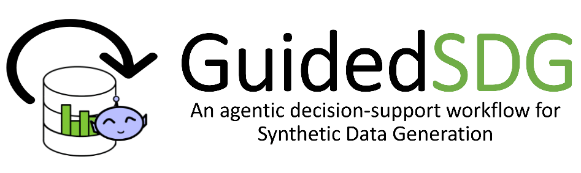

<picture>
  <source media="(prefers-color-scheme: dark)" srcset="src/agentic_synth_data/images/icon-dark.png">
  <source media="(prefers-color-scheme: light)" srcset="src/agentic_synth_data/images/icon.png">
  
</picture>

GuidedSDG is a Large Language Model (LLM) assisted workflow for synthetic tabular data generation and evaluation.

The application guides users through data preparation, generator selection, synthetic data generation, and evaluation. It incorporates human-in-the-loop (HITL) interactions, allowing users to review and revise agent recommendations throughout the workflow.


## Getting started


### 1. Prerequisites


#### 1.1 Install the project dependencies

Verify that [UV](https://docs.astral.sh/uv/getting-started/installation/) is installed. 
Enter the following into the terminal:
```bash
uv sync
```


#### 1.2 Install one of the following container engines

Verify that one of the following is on your system:

- [Podman](https://podman.io/) with [Podman Compose](https://github.com/containers/podman-compose#installation)

- [Docker](https://docs.docker.com/get-docker/) with [Docker Compose](https://docs.docker.com/compose/install/)

Verify the installation:

```bash
# If Podman and Podman-Compose is installed:
podman --version
podman compose version

# If Docker and Docker-Compose is installed:
docker --version
docker compose version
```


#### 2. Configure environment variables
Create a `.env` file with the necessary API credentials for the configured language model.
- Note: OpenAI compatible APIs are currently permitted.

```python
# Supported Streamlit providers: openai, ollama, lm-studio
MODEL_PROVIDER=openai
MODEL_ID=your-model-identifier

# Authentication (required for hosted OpenAI-compatible APIs)
OPENAI_API_KEY=your-api-key

# API endpoint (optional if using the provider's default)
BASE_URL=https://your-provider-endpoint/v1
```


#### 3. Start the application

The application uses two containers:

**guided-sdg**: Runs the Streamlit interface and workflow.

**sdr**: Runs the Synthetic Data Release generators through an HTTP API.

```bash
# Option A: use the container images published on GitHub Container Registry
podman compose pull
podman compose up -d

# Using Docker:
docker compose pull
docker compose up -d
```

```bash
# Option B: build the images from source
podman compose up -d --build

# Using Docker:
docker compose up -d --build
```

Click [here](http://localhost:8080) to access the Streamlit interface after running the container.

To stop the containers:
```bash
# Using Podman:
podman compose down

# Using Docker:
docker compose down
```


#### 4. Start the Streamlit user interface without containers
Enter the following into the terminal:
```bash
streamlit run ./src/agentic_synth_data/ui/main.py
```
---

## Workflow:

| Step | | Description | LLM assistance |
|------|---------|-------------|-----------|
| 1 | | Load dataset and configure LLM agent. | |
| 2 | | Select synthesis preferences. | |
| 3 | a) | Detect and standardize missing value markers. | |
| | b) | Infer Python data types and semantic types. | ✓ |
| | c) | Select covariates. | |
| | d) | Split data into training and test sets. | |
| | e) | Recommend generator (CTGAN, PATEGAN, BayesianNet, PrivBayes). | ✓ |
| | f) | Recommend and apply a missing value handling strategy (if necessary). | ✓ |
| 4 | a) | Save the prepared dataset. | |
| | b) | Generate metadata for generator input. | |
| 5 | | Generate synthetic data using the selected generator. | |
| 6 | a) | Calculate fidelity and privacy evaluation metrics. | |
| | b) | Interpret evaluation results and recommend improvements. | ✓ |
| | c) | Generate a workflow report. | |
| 7 | | Optionally revise workflow decisions and repeat generation and evaluation. | ✓ |

*Info:* Each check mark (✓) indicates that the LLM agent is invoked to assist during the workflow. The agent is only involved in making suggestions.

## Container images

The images referenced by `compose.yaml` are built by CI and published to the
GitHub Container Registry:

| Image | Contents |
|-------|----------|
| `ghcr.io/scai-bio/agentic-synth-data/guided-sdg` | Streamlit interface and workflow |
| `ghcr.io/scai-bio/agentic-synth-data/sdr` | Synthetic Data Release generators served over HTTP |

`.github/workflows/ci.yaml` builds both images on every push and pull request to
`main`, and `.github/workflows/deploy.yaml` publishes both of them (tagged
`latest` and with the release version) whenever a GitHub release is published.
The packages have to be public in the GitHub package settings, otherwise
`docker compose pull` fails with a permission error.

## Releases and Zenodo

The Zenodo record metadata is declared in `.github/zenodo-sync.json` (with a
legacy copy in `.zenodo.json`) and applied by `.github/workflows/zenodo.yaml`
using [zenodo-schema-sync](https://github.com/tiadams/zenodo-schema-sync).
Citation metadata for GitHub is provided in [`CITATION.cff`](CITATION.cff).

The workflow requires a repository secret named `ZENODO_TOKEN` that holds a
Zenodo personal access token with the `deposit:write` and `deposit:actions`
scopes. On its first successful run the record is created and published on
Zenodo; the resulting DOI should then be added to `CITATION.cff` and to this
README.

## References
- **Syndat:** Adams, T., Birkenbihl, C., Otte, K., et al. (2025).
  *On the fidelity versus privacy and utility trade-off of synthetic patient data*.
  iScience, 28.
  [Publication](https://doi.org/10.1016/j.isci.2025.112382) |
  [GitHub](https://github.com/SCAI-BIO/syndat)
- **Anonymeter:** Giomi, M., Boenisch, F., Wehmeyer, C., & Tasnádi, B. (2023).
  *A Unified Framework for Quantifying Privacy Risk in Synthetic Data*.
  Proceedings on Privacy Enhancing Technologies.
  [Publication](https://doi.org/10.56553/popets-2023-0055) |
  [GitHub](https://github.com/statice/anonymeter)
- **Synthetic Data Release:** Stadler, T., Oprisanu, B., & Troncoso, C. (2022).
  *Synthetic Data – Anonymisation Groundhog Day*.
  31st USENIX Security Symposium.
  [Publication](https://www.usenix.org/conference/usenixsecurity22/presentation/stadler) |
  [GitHub](https://github.com/spring-epfl/synthetic_data_release)

### Icon attribution
- <a href="https://www.flaticon.com/free-icons/chart" title="chart icons">Chart icons created by mynamepong - Flaticon</a>

## Project structure
```bash
guided-sdg
├── .github # Dependabot, CI, container deploy, and Zenodo workflows
├── compose.yaml # Container configuration
├── .env # LLM API configuration
├── CITATION.cff # Citation metadata
├── data # Input and prepared datasets
├── demo_data # Example dataset
│   └── mix_titanic.csv
├── notebooks # Example workflow notebook
├── output # Versioned generation results
│   └── version_1
│       ├── synthetic_*_*_v*.csv # Generated synthetic dataset
│       ├── plots # Evaluation visualizations
│       └── report_*.md # Workflow report
├── sdr_service # Synthetic data generator service
└── src
    └── agentic_synth_data
```
